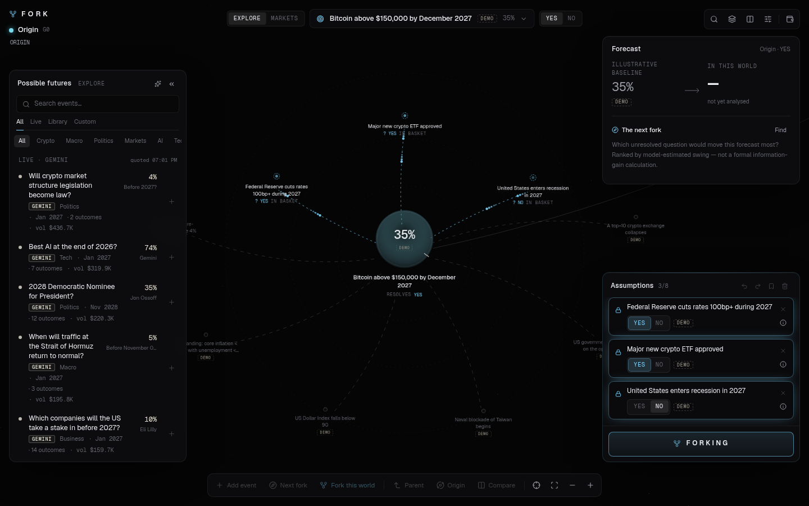
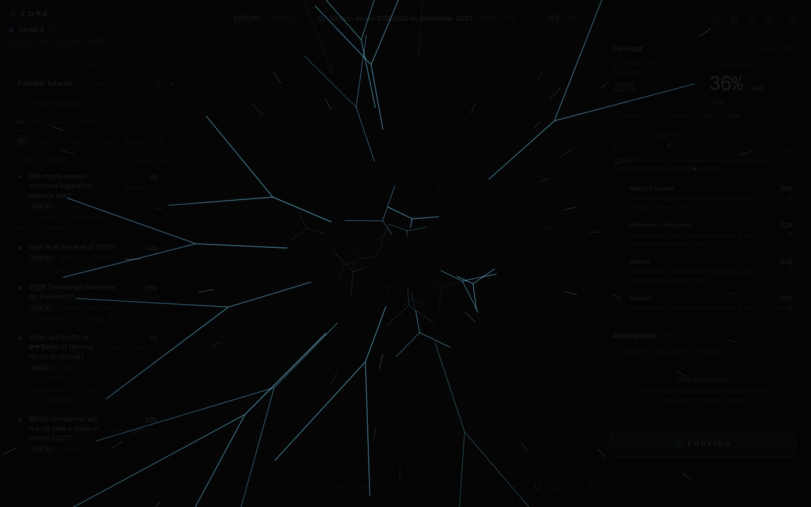
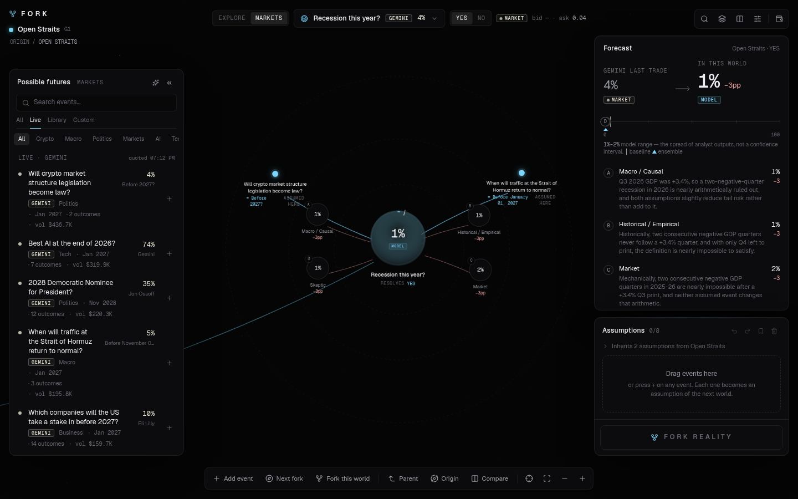
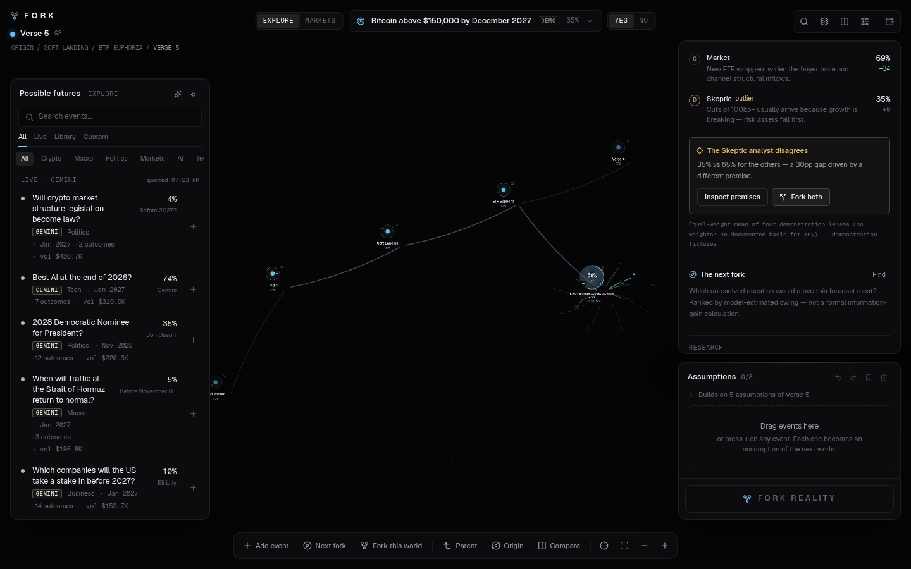

# FORK

**An interactive multiverse engine for conditional forecasting.**
Choose an event. Change the assumptions. Explore what happens next.

You pick a target (a live Gemini prediction market, or a defined hypothetical),
drag other events into a basket, choose how each one resolves, and press
**FORK REALITY**. The graph converges, ruptures and travels to a new *Verse*: a
saved hypothetical world where four AI analysts estimate the target under your
assumptions. You can name it, inspect where the analysts disagree, fork again,
and compare worlds side by side.


---

## Run it

```bash
cd fork
npm install
npm run dev          # http://localhost:3000
```

No API keys are required.

- **Live market data:** Gemini's public Prediction Markets API (no key needed for reads).
- **Model analysis:** the local **Claude Code CLI** (`claude -p`), authenticated with your Claude subscription. If `claude` is not on the server's `PATH`, FORK switches to its labelled **demonstration engine** on its own.
- **Demo engine on demand:** choose *Settings → Forecast engine → DEMONSTRATION* to get instant, deterministic results.

Production:

```bash
npm run build && npm start
```

Tests (the server must be running; E2E uses the demo engine):

```bash
npx playwright install chromium            # or: PW_CHROMIUM=/path/to/chrome
BASE_URL=http://localhost:3000 npx playwright test
```

### Environment variables

All are optional. See [`.env.example`](.env.example).

| Variable | Default | Purpose |
| --- | --- | --- |
| `FORK_ENGINE` | `auto` | `auto` uses `claude -p` when available; `demo` forces fixtures |
| `FORK_CLAUDE_BIN` | `claude` | Path to the Claude Code CLI |
| `FORK_CLAUDE_MODEL` | `sonnet` | Model alias for analysts and the revision round |
| `FORK_CLAUDE_RESEARCH_MODEL` | = model | Model for the WebSearch research step |
| `FORK_CLAUDE_FAST_MODEL` | = model | Model for "Find the next fork" |
| `FORK_CLAUDE_CONCURRENCY` | `4` | Max parallel CLI processes |
| `FORK_RESEARCH` | `1` | `0` skips web research |
| `FORK_REVISION` | `auto` | Revision round: `auto` (only on significant disagreement), `1` (always), `0` (never) |
| `FORK_DB_PATH` | `.data/fork.sqlite` | SQLite file (forecasts, universe mirror, research cache) |
| `GEMINI_API_BASE` | `https://api.gemini.com` | Gemini REST base URL |
| `NEXT_PUBLIC_SOLANA_CLUSTER` | `devnet` | Solana cluster |
| `NEXT_PUBLIC_SOLANA_RPC` | public devnet | Custom RPC endpoint |
| `NEXT_DIST_DIR` | `.next` | Build directory, so a production build can run beside `next dev` |

---

## What is live, what is a demonstration, what is incomplete

Every probability in the UI carries a tag: **MARKET** (a real observed price),
**MODEL** (generated by an AI analyst in this app) or **DEMO** (hand-authored and
illustrative). Event sources are tagged **Gemini**, **Demo**, **Custom** or
**Model-proposed**.

| Area | Status |
| --- | --- |
| Gemini Prediction Markets (events, contracts, best bid/ask, last trade, volume, expiry, resolution text) | **Live.** Fetched server-side from documented public endpoints, cached 90s with stale-while-revalidate, throttled to 1 request/s. Missing quotes stay missing. Nothing is substituted. |
| Implied probability | **Live, derived:** mid of best bid/ask; last trade if one side is empty; no estimate if only one side quotes. Binary NO is the complement of the YES book. |
| Four-analyst forecasting (`claude -p`) | **Live** when the CLI is present. Research (WebSearch, cited) → 4 role analysts in parallel, blind to each other → disagreement analysis → optional revision (arguments only, numbers withheld) → equal-weight mean → zod validation → SQLite. Verified end to end (see Test results). |
| Find the next fork | **Live** (model-ranked by estimated swing P(target \| outcome)); **demo** ranking from fixtures in demo mode. Not a formal information-gain calculation, and the UI says so. |
| Demo engine and demo library | **Demonstration.** 4 targets and 14 hypothetical events with authored, illustrative log-odds effects. Labelled DEMO everywhere. Live events added to a demo-engine scenario are explicitly ignored, never invented. |
| Verse persistence | **Live:** localStorage (primary) plus a debounced mirror to server SQLite. Forecasts are immutable once complete; reopening a Verse shows the original analysis. |
| Solana: wallet + Verse attestation | **Implemented, not verified onchain from this server.** Wallet Standard discovery (Phantom, Solflare, …), devnet. "Anchor this Verse" sends a real SPL Memo transaction containing `FORK1|<verseId>|sha256(verse+forecast)`, signed by the user's wallet; success is shown only after confirmation, with an explorer link. A full devnet round-trip couldn't be run here: the devnet RPC faucet returns *410 (closed)* and the public RPC rate-limited simulation (429). `scripts/verify-devnet-memo.mjs` runs that check on a machine with devnet SOL. |
| FORK Positions (collateralised conditional claims) | **Not deployed.** Anchor program source in [`programs/fork_positions`](programs/fork_positions/README.md). It was not compiled (no Rust toolchain here). The UI labels it *not deployed* and has no simulated positions. |

---

## The journey

1. **Origin:** a near-black canvas and one question. The welcome orb sits exactly on the Origin's target node; choosing a target drops the camera into it.
2. **Discover:** browse *Possible futures*: live Gemini markets, the demo library, custom events (✦), or ⌘K.
3. **Build the basket:** drag an event from the panel *or from the graph* toward the tray. It reacts to proximity, pulls the item in magnetically, and springs it into place. Click **+** as the accessible alternative. Set each outcome with segmented YES/NO controls or categorical outcome lists. Reorder, remove, undo (⌘Z), save a draft. Mutually exclusive assumptions raise a warning that you must acknowledge.
4. **FORK REALITY:** a state machine runs *commit → converge → rupture → travel → arrive → reveal*. The basket locks and pulses run along the assumption edges. Assumptions converge into the target. A luminance pulse and radial warp follow. The camera then travels through a tunnel of branching paths and the new world assembles. About 3.4s in total; under reduced motion it becomes a short crossfade. Re-entry is ignored while a transition runs.
5. **Arrive:** name the Verse (suggested names come from its assumptions). The four analyst nodes resolve one by one as real results land; the dial and the number animate only when a new value arrives.
6. **Disagreement:** when one analyst diverges by ≥12pp from the others' median (and the range is ≥15pp), a diamond node appears. *Inspect premises* shows both narratives, each attributed to its analysts. *Fork both* splits the world into two sibling Verses, one per premise.
7. **Fork deeper:** children inherit every ancestor assumption. The basket and graph separate *inherited*, *assumed here*, *proposed (in basket)* and *related (merely considered)*.
8. **Navigate and compare:** breadcrumb, Parent/Origin, the Universe tree, double-click any Verse node. Compare shows the probability gap, the shared ancestor, assumptions unique to each side, contested resolutions and per-analyst reasons, with a reminder that the gap is not causal.
9. **Markets mode:** live first. Shows the order book (bid/ask/last/implied, data quality), volume, expiry, a Gemini link and related live markets.
10. **Onchain:** connect a devnet wallet and anchor a Verse's fingerprint.

---

## Architecture

```
fork/
  src/app/                  Next.js App Router (single immersive page + API routes)
    api/events              Gemini search/browse (normalised)      → lib/server/gemini.ts
    api/events/[ticker]     Gemini event by ticker (fresh quotes)
    api/forecast            POST start (idempotent by id)          → lib/server/engine.ts
    api/forecast/[id]       GET progress/result (polled every 1.5s)
    api/next-fork           POST ranking of unresolved questions
    api/universe            PUT/GET server mirror (SQLite)
    api/status              engine detection (claude CLI version)
  src/lib/domain/           zod schemas (Event, MarketSnapshot, Assumption, Verse,
                            Forecast, AnalystOutput…), Verse geometry/naming,
                            market math, Gemini normalisation (pure, unit-tested)
  src/lib/server/           claude.ts (CLI runner, isolation flags, concurrency gate),
                            engine.ts (orchestrator), gemini.ts (cache + 1 rps gate),
                            db.ts (node:sqlite)
  src/lib/demo/             demonstration library + deterministic demo engine
  src/lib/forecast/         aggregation + disagreement (shared server/client)
  src/store/                universe.ts (persisted: verses, forecasts, basket+undo,
                            attestations) · ui.ts (ephemeral: hover, drag, panels,
                            fork phase state machine)
  src/components/graph/     engine.ts — imperative renderer: spring physics, camera,
                            canvas edges/particles/starfield/tunnel, fork choreography
                            model.ts — store → node/edge specs (ids scoped per Verse)
                            GraphView/nodes/NodePopover — DOM nodes + tooltips
  src/components/…          basket, discovery, forecast, verse (naming/compare/tree),
                            hud, solana
  programs/fork_positions/  Anchor program draft (not deployed)
  tests/                    unit (domain) + e2e (journey) — Playwright runner
```

**Key decisions**

- **Bespoke renderer instead of React Flow.** The graph is a Canvas 2D layer
  (edges, pulses, starfield, warp, branch tunnel) under absolutely positioned DOM
  nodes (crisp text, focusable `<button>`s, screen-reader labels). The engine writes
  transforms directly each frame. React re-renders only when the graph's
  *composition* changes, never on typing or pointer motion. The physics is
  anchored springs, local repulsion and drag coupling, plus a tiny idle drift.
  Positions are not coupled to API responses.
- **Separated state:** universe (persisted) vs UI (ephemeral) vs graph/camera
  (engine-owned) vs forecast requests (server jobs plus polling) vs transition
  (`forkPhase` state machine).
- **HUD-aware camera:** framing centres the world in the space the panels leave
  open. Semantic zoom keeps Verse landmarks legible in the overview.
- **`claude -p` isolation:** `--setting-sources ""`, a replacement `--system-prompt`,
  `--tools ""` (WebSearch only for research), `--no-session-persistence` and
  `--json-schema` for structured output. Each output is validated again with zod.
  Citations are only kept when the URL came from the research step.
- **Equal weights.** There is no documented basis for weighting roles, so the
  aggregate is a plain mean, stated in the UI. The disagreement thresholds
  (15pp range, 12pp outlier) are display choices, labelled as such in code.
- **Honesty rules in code:** failed analysts are shown as failed and never
  substituted; lost jobs are marked lost; one-sided books give no estimate;
  forecasts never transfer between targets; demo fixtures are labelled.

Typography: **Geist / Geist Mono** (SIL OFL 1.1, bundled via the `geist` package).
Icons: **Lucide** (ISC). See [NOTICES.md](NOTICES.md).

---

## Test results

Run on 2026-11-17, headless Chromium 1243. Results were identical against `next dev` and the production build (`next build && next start`):

```
15 passed (59.4s)
  e2e  1–2   loads, welcome renders, target search finds events
  e2e  3–18  basket (click-add, drag-add, outcome change, remove, undo), fork with
             rapid re-click (exactly one child created), naming, deeper fork with
             inheritance, parent/origin navigation, reload persistence, analyst
             inspector, disagreement view, compare, target switch + re-analysis
  e2e  19–20 demo engine without credentials; reduced-motion fork < 2.5s
  e2e  21    no horizontal overflow at 1280×800, 820×1180, 390×844
  e2e  22    no runtime errors recorded across the run
  unit ×8    demo engine math, complement, unauthored-effect honesty, next-fork
             ordering, disagreement/partial ensembles, market mid/complement/
             one-sided, Verse placement/ancestry/inheritance
```

Also verified manually:

- **Live `claude -p` engine:** `/api/forecast` returned research with 6 cited sources and 4 valid analyst outputs (ensemble 13% for BTC > $150k by Dec 2027 given Fed cuts and no recession). In the UI, Markets mode on Gemini `RECESSION26` gave 1% vs the market's 4%, with cited research sources (BEA, Reuters and others). The first attempt surfaced a CLI schema error; the UI showed "All analysts failed" with no number, as designed.
- **Production build:** `next build` succeeds; eslint is clean; `tsc` is clean.
- **Frame rate:** ~20 fps in *software-rendered* headless Chromium (SwiftShader, no GPU) on a 4-core server. That isn't representative of a laptop GPU, and 60 fps was **not measured** on real hardware.

## Screenshots

| | |
| --- | --- |
|  basket |  fork · commit |
|  fork · converge / rupture |  fork · travel |
|  arrival + naming |  disagreement |
|  markets mode |  live analysis progress |
|  live Claude forecast |  research + onchain |
|  compare |  universe overview |
|  graph → basket (magnetic) |  mobile |

## Known limitations

- Solana devnet attestation is implemented but was not confirmed onchain from this server (faucet closed / RPC rate limits), and no wallet extension exists in headless tests.
- FORK Positions is a source-level design only.
- Live analysis takes about 1–3 minutes (research plus four parallel CLI runs). The UI shows real step-by-step progress rather than blocking. Analyses run inside the Next.js server process: a restart mid-run marks that job as lost rather than resuming it.
- The four analysts share one model family. Treat their spread as disagreement between prompts, not between independent forecasters.
- The demo library's baselines are illustrative. Research during testing put BTC near $65k in mid-2026, far from what the 35% demo baseline implies.
- Gemini categorical events: each outcome is a separate YES contract. FORK treats an assumption on a categorical event as choosing one outcome, so two outcomes of the same event can't both be assumed.
- The server mirror of the universe is keyed by an anonymous browser id. There is no restore-from-server UI if browser storage is wiped.
- Mobile uses a simplified layout (bottom sheet for Discover, Basket and Forecast). Dragging events into the basket is desktop-first; tap **+** on touch devices.
