# FORK

**An interactive multiverse engine for conditional forecasting.**
Choose an event. Change the assumptions. Explore what happens next.

You pick a target (a live Gemini prediction market, or a defined hypothetical),
drag other events into a basket, choose how each one resolves, and press
**FORK REALITY**. The graph converges, ruptures and travels to a new *Verse*: a
saved hypothetical world where four AI analysts, drawn from three model families
(Claude, Codex and Grok) and run in parallel, estimate the target under your assumptions. You can name it, inspect where the analysts disagree, fork again,
and compare worlds side by side.

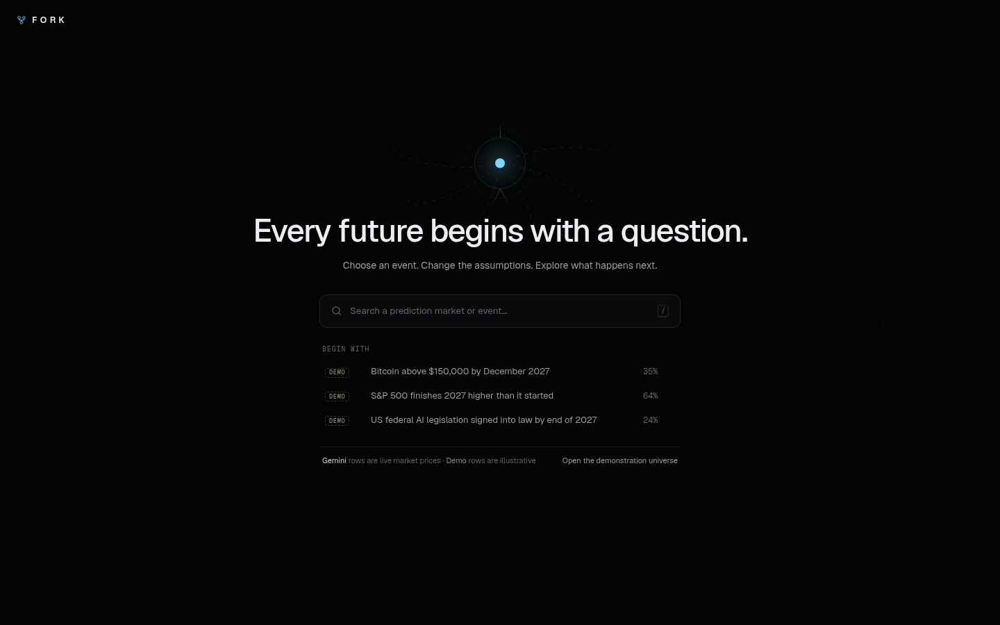

---

## Demo video

[**docs/demo/fork-demo.mp4**](docs/demo/fork-demo.mp4) (3:12), recorded from the running product on
2026-11-20: live Gemini markets, a live Claude + Codex + Grok analysis (the ~70 s wait is
sped up 7×, typing 1.4×), an if-then buy executed on Solana devnet, Compare and Atlas. The
Solana explorer refused the headless browser, so the video ends on a card with the trade
signature to verify instead.

## Solana: trade with devnet SOL (Trade tab)

Next to **If this happens, buy** (mock USDC, automatic), the **Trade** tab lets a wallet
trade conditional markets with **native devnet SOL** on the same program
(`13Z5QXDCa7bNddx55di4qxg7cAepcjy8BjDxag9bBJdN`). Use **Trade → Available markets → Open in
graph & trade** to restore a market's exact target and condition in the graph, or select a
live target and condition and **Build this market** after reviewing both source rules.
Connect a devnet wallet, deposit SOL, review a YES/NO buy or sell, sign, and withdraw after
settlement. A winning share pays 1 SOL; if the condition fails, deposits are refunded.
Markets are sized from a 0.1 SOL budget, LPs earn a 1% trading fee (cancelled on VOID),
and the app never mints SOL. Contributed by PR #3; see the [SOL walkthrough](docs/devnet.md)
and [liquidity design](contracts/docs/liquidity.md).

The two kinds of collateral run as two instances of one service:
`FORK_COLLATERAL=mock contracts/scripts/devnet-service.sh` (port 8788, rules) and
`FORK_COLLATERAL=sol contracts/scripts/devnet-service.sh` (port 8789, Trade tab); start the
app with `FORK_LOCAL_SERVICE=http://127.0.0.1:8788 FORK_SOL_SERVICE=http://127.0.0.1:8789`,
or run `npm run dev:devnet` for all three. Without `FORK_SOL_SERVICE` the Trade tab is hidden.

## Solana: "If this happens, buy" (devnet)

The conditional-market program is **deployed on Solana devnet** at
[`13Z5QXDCa7bNddx55di4qxg7cAepcjy8BjDxag9bBJdN`](https://explorer.solana.com/address/13Z5QXDCa7bNddx55di4qxg7cAepcjy8BjDxag9bBJdN?cluster=devnet)
(on-chain bytes verified identical to `target/deploy/fork_contracts.so`, sha256 `30c26287…`).

In any world whose target is a live Gemini market, the **If this happens, buy** card says:
*if* one of this world's assumptions (a live Gemini outcome) *hits* N% odds on Gemini,
*buy* shares of the target. Arming it registers the exact Gemini contracts on-chain,
creates the market "B given A = YES" if needed (integer LMSR with a mock-USDC subsidy),
escrows the max cost, and the FORK service watches A's Gemini odds every 15 s. When the
line is crossed it buys once, with the max cost enforced on-chain as the trade limit.
If A ends up not happening the market voids and every deposit is refunded. The top-bar ⚡
lists every rule. Trades run from FORK's auto-trader account with **mock USDC**; the
oracle (Gemini result → on-chain report) is FORK's service key. Verified on devnet
2026-11-20: rule armed in 22 s, fired at 98.5%, trade
[`5JqcHLWW…`](https://explorer.solana.com/tx/5JqcHLWW8LxK7EC9WFb4DzTpWWdXsxD83i8A7vNNsY23fsLS36vyjisD2E4NycXfs3LfbD5eMifZ8Ptdp4ZEa7Xp?cluster=devnet).

Run the service: `fork/contracts/scripts/devnet-service.sh` (uses a Helius devnet RPC if
`~/.config/helius/api_key` exists, otherwise public devnet; the key never reaches the
browser, logs or error messages), then start the app with
`FORK_LOCAL_SERVICE=http://127.0.0.1:8788`. Details: [integration](docs/integration.md),
[verification](docs/verification.md).

## Run it

From this directory, install both packages and generate the Anchor client:

```bash
npm run setup
cp .env.example .env.local
```

Then run each process in its own terminal, all from `fork/`:

```bash
npm run validator   # persistent local validator and deployed program
npm run oracle      # mock collateral, configuration, live Gemini oracle
npm run dev -- --hostname 127.0.0.1  # http://127.0.0.1:3000
```

`npm run verify` builds and checks both packages. Browser tests additionally need
these services running; see [the workflow](docs/integration.md) for live and
fixture test commands. `npm run build` and `npm run dev` automatically synchronize
the generated client from the built contracts.

No Gemini API keys are required. Generate the browser IDL first with
`npm --prefix contracts run app:sync` after building the contracts.

- **Live market data:** Gemini's public Prediction Markets API (no key needed for reads).
- **Model analysis:** two local CLIs, each logged in with your own subscription:
  - **Claude Code** (`claude -p`, Claude subscription)
  - **OpenAI Codex** (`codex exec`, ChatGPT login)
  - **xAI Grok** (`grok -p`, grok.com login; needs grok CLI ≥ 1.0.13)

  By default the analysts are **mixed**: A Claude · B Codex · C Grok · D Codex (with only two CLIs installed, the roles spread over those two). Research and "Find the next fork" fan out to **every** installed family in parallel and merge the results. *Settings → Analysts* switches to a single family. If no CLI is installed, FORK switches to its labelled **demonstration engine** on its own.
- **Demo engine on demand:** choose *Settings → Forecast engine → DEMONSTRATION* to get instant, deterministic results.

Production:

```bash
npm run build && npm start
```

Tests (the server must be running; E2E uses the demo engine):

```bash
npx playwright install chromium            # or: PW_CHROMIUM=/path/to/chrome
BASE_URL=http://localhost:3000 npx playwright test
```

### Environment variables

All are optional. See [`.env.example`](.env.example).

| Variable | Default | Purpose |
| --- | --- | --- |
| `FORK_ENGINE` | `auto` | `auto` uses `claude -p` when available; `demo` forces fixtures |
| `FORK_CLAUDE_BIN` | `claude` | Path to the Claude Code CLI |
| `FORK_CLAUDE_MODEL` | `sonnet` | Model alias for analysts and the revision round |
| `FORK_CLAUDE_RESEARCH_MODEL` | = model | Model for the WebSearch research step |
| `FORK_CLAUDE_FAST_MODEL` | = model | Model for "Find the next fork" |
| `FORK_CLAUDE_CONCURRENCY` | `4` | Max parallel `claude` processes |
| `FORK_CODEX_BIN` | `codex` | Path to the Codex CLI (must be logged in: `codex login`) |
| `FORK_CODEX_MODEL` | Codex default | Model for Codex analysts (`-m`) |
| `FORK_CODEX_EFFORT` | `low` | `model_reasoning_effort` for Codex |
| `FORK_CODEX_CONCURRENCY` | `4` | Max parallel `codex` processes |
| `FORK_CODEX` | `1` | `0` disables Codex even if installed |
| `FORK_GROK_BIN` | `grok` | Path to the Grok CLI (must be logged in: `grok login`) |
| `FORK_GROK_MODEL` | Grok default | Model for Grok analysts (`-m`) |
| `FORK_GROK_EFFORT` | `low` | `--reasoning-effort` (measured: default 128s vs low 26s per analyst call) |
| `FORK_GROK_CONCURRENCY` | `4` | Max parallel `grok` processes |
| `FORK_GROK` | `1` | `0` disables Grok even if installed |
| `FORK_RESEARCH_GRACE_MS` | `25000` | After the first research provider answers, how long to wait for the others |
| `FORK_RESEARCH` | `1` | `0` skips web research |
| `FORK_REVISION` | `auto` | Revision round: `auto` (only on significant disagreement), `1` (always), `0` (never) |
| `FORK_DB_PATH` | `.data/fork.sqlite` | SQLite file (forecasts, universe mirror, research cache) |
| `GEMINI_API_BASE` | `https://api.gemini.com` | Gemini REST base URL |
| `NEXT_PUBLIC_SOLANA_CLUSTER` | `devnet` | Solana cluster |
| `NEXT_PUBLIC_SOLANA_RPC` | public devnet | Custom RPC endpoint |
| `FORK_LOCAL_SERVICE` | unset | Mock-collateral service URL (if-then rules); unset hides them |
| `FORK_SOL_SERVICE` | unset | Native-SOL service URL (Trade tab); unset hides the tab |
| `NEXT_DIST_DIR` | `.next` | Build directory, so a production build can run beside `next dev` |
| `NEXT_DIST_DIR` | `.next` | Build directory, so a production build can run beside `next dev` |

---

## What is live, what is a demonstration, what is incomplete

Every probability in the UI carries a tag: **MARKET** (a real observed price),
**MODEL** (generated by an AI analyst in this app) or **DEMO** (hand-authored and
illustrative). Event sources are tagged **Gemini**, **Demo**, **Custom** or
**Model-proposed**.

| Area | Status |
| --- | --- |
| Gemini Prediction Markets (events, contracts, best bid/ask, last trade, volume, expiry, resolution text) | **Live.** Fetched server-side from documented public endpoints, cached 90s with stale-while-revalidate, throttled to 1 request/s. Missing quotes stay missing. Nothing is substituted. |
| Market search | **Live.** Gemini's own `search` filter matches titles only (`search=iran` → 0 results on 2026-11-19, though Hormuz, Israel-PM and world-leader markets exist). FORK ranks the whole non-sports catalog by title, outcome labels, tags and resolution rules, accent-insensitively, merges Gemini's title search, and, when a term has few direct hits, shows *related* markets from a small hand-written topic map (an ASSUMPTION, in `domain/event-search.ts`). Every row says why it matched. |
| Odds over time | **Live.** Gemini `GET /v2/candles/{instrumentSymbol}/{tf}`: 1D = 15m, 1W = 1h, 1M = 6h, ALL = daily since listing. This endpoint is documented for spot symbols and not listed in the prediction-markets docs, but it accepts contract symbols (verified 2026-11-19). The line shows traded closes; this Verse's MODEL estimate is overlaid as a dashed line, and the gap is measured against the same bid/ask mid the forecast used. DEMO numbers are never overlaid. |
| Implied probability | **Live, derived:** mid of best bid/ask; last trade if one side is empty; no estimate if only one side quotes. Binary NO is the complement of the YES book. |
| Four-analyst forecasting (`claude -p` + `codex exec` + `grok -p`) | **Live** when any CLI is present. Research fans out to every installed family in parallel (each does its own web search; findings are merged, de-duplicated by URL, and the research note names who contributed) → 4 role analysts in parallel, blind to each other → disagreement analysis → optional revision (arguments only, numbers withheld; each analyst revises on its own provider) → equal-weight mean → zod validation → SQLite. A failed analyst retries once on *another* family and is labelled with the model that actually answered. Every analyst row and graph node shows its provider. Verified end to end in mixed, Claude-only and Codex-only modes. |
| Find the next fork | **Live:** every installed family is asked in parallel; a question several families raise independently ranks first (tagged with who proposed it), then by estimated swing P(target \| outcome); **demo** ranking from fixtures in demo mode. Not a formal information-gain calculation, and the UI says so. |
| Demo engine and demo library | **Demonstration.** 4 targets and 14 hypothetical events with authored, illustrative log-odds effects. Labelled DEMO everywhere. Live events added to a demo-engine scenario are explicitly ignored, never invented. |
| Verse persistence | **Live:** localStorage (primary) plus a debounced mirror to server SQLite. Forecasts are immutable once complete; reopening a Verse shows the original analysis. |
| Solana: wallet + Verse attestation | **Implemented, not verified onchain from this server.** Wallet Standard discovery (Phantom, Solflare, …), devnet. "Anchor this Verse" sends a real SPL Memo transaction containing `FORK1|<verseId>|sha256(verse+forecast)`, signed by the user's wallet; success is shown only after confirmation, with an explorer link. A full devnet round-trip couldn't be run here: the devnet RPC faucet returns *410 (closed)* and the public RPC rate-limited simulation (429). `scripts/verify-devnet-memo.mjs` runs that check on a machine with devnet SOL. |
| If this happens, buy (conditional markets on Solana) | **Live on devnet.** Anchor program in [`contracts/`](contracts/README.md): an integer LMSR market for *B given A=YES*, bound to exact Gemini instruments; A=NO or INVALID voids and refunds every deposit. Rules are armed from a world, watched against Gemini every 15 s, executed once by FORK's auto-trader (mock USDC) with an on-chain cost cap. Oracle reports come from FORK's service key (trusted, publicly auditable). Live Gemini settlement is still unverified. Without the service the card is hidden and the rest of the app is unaffected. |
| Graph-linked trading with devnet SOL (Trade tab) | **Implemented (PR #3), verified on a local validator against this program build:** wallet deposits native SOL atomically, buys and sells, VOID/YES/NO redemption once each. Requires the program upgrade on devnet plus `FORK_SOL_SERVICE`; hidden otherwise. See [docs/devnet.md](docs/devnet.md). |

---

## The journey

1. **Origin:** a near-black canvas and one question. The welcome orb sits exactly on the Origin's target node; choosing a target drops the camera into it.
2. **Discover:** browse _Possible futures_: live Gemini markets, the demo library, custom events (✦), or ⌘K.
3. **Build the basket:** drag an event from the panel _or from the graph_ toward the tray. It reacts to proximity, pulls the item in magnetically, and springs it into place. Click **+** as the accessible alternative. Set each outcome with segmented YES/NO controls or categorical outcome lists. Reorder, remove, undo (⌘Z), save a draft. Mutually exclusive assumptions raise a warning that you must acknowledge.
4. **FORK REALITY:** a state machine runs _commit → converge → rupture → travel → arrive → reveal_. The basket locks and pulses run along the assumption edges. Assumptions converge into the target. A luminance pulse and radial warp follow. The camera then travels through a tunnel of branching paths and the new world assembles. About 3.4s in total; under reduced motion it becomes a short crossfade. Re-entry is ignored while a transition runs.
5. **Arrive:** name the Verse (suggested names come from its assumptions). The four analyst nodes resolve one by one as real results land; the dial and the number animate only when a new value arrives.
6. **Disagreement:** when one analyst diverges by ≥12pp from the others' median (and the range is ≥15pp), a diamond node appears. _Inspect premises_ shows both narratives, each attributed to its analysts. _Fork both_ splits the world into two sibling Verses, one per premise.
7. **Fork deeper:** children inherit every ancestor assumption. The basket and graph separate _inherited_, _assumed here_, _proposed (in basket)_ and _related (merely considered)_.
8. **Navigate and compare:** breadcrumb, Parent/Origin, the Universe tree, double-click any Verse node. Compare shows the probability gap, the shared ancestor, assumptions unique to each side, contested resolutions and per-analyst reasons, with a reminder that the gap is not causal.
9. **Markets mode:** live first. Shows the order book (bid/ask/last/implied, data quality), volume, expiry, a Gemini link and related live markets.
10. **Onchain:** connect a devnet wallet and anchor a Verse's fingerprint.

---

## Architecture

```
fork/
  src/app/                  Next.js App Router (single immersive page + API routes)
    api/events              Gemini search/browse (normalised)      → lib/server/gemini.ts
    api/events/[ticker]     Gemini event by ticker (fresh quotes)
    api/forecast            POST start (idempotent by id)          → lib/server/engine.ts
    api/forecast/[id]       GET progress/result (polled every 1.5s)
    api/next-fork           POST ranking of unresolved questions
    api/universe            PUT/GET server mirror (SQLite)
    api/status              engine detection (claude CLI version)
  src/lib/domain/           zod schemas (Event, MarketSnapshot, Assumption, Verse,
                            Forecast, AnalystOutput…), Verse geometry/naming,
                            market math, Gemini normalisation (pure, unit-tested)
  src/lib/server/           providers.ts (registry, role→provider assignment),
                            claude.ts / codex.ts (CLI runners, isolation, concurrency),
                            engine.ts (orchestrator), gemini.ts (cache + 1 rps gate),
                            db.ts (node:sqlite)
  src/lib/demo/             demonstration library + deterministic demo engine
  src/lib/forecast/         aggregation + disagreement (shared server/client)
  src/store/                universe.ts (persisted: verses, forecasts, basket+undo,
                            attestations) · ui.ts (ephemeral: hover, drag, panels,
                            fork phase state machine)
  src/components/graph/     engine.ts — imperative renderer: spring physics, camera,
                            canvas edges/particles/starfield/tunnel, fork choreography
                            model.ts — store → node/edge specs (ids scoped per Verse)
                            GraphView/nodes/NodePopover — DOM nodes + tooltips
  src/components/…          basket, discovery, forecast, verse (naming/compare/tree),
                            hud, solana
  docs/legacy/fork_positions/  Anchor program draft (not deployed)
  tests/                    unit (domain) + e2e (journey) — Playwright runner
```

**Key decisions**

- **Bespoke renderer instead of React Flow.** The graph is a Canvas 2D layer
  (edges, pulses, starfield, warp, branch tunnel) under absolutely positioned DOM
  nodes (crisp text, focusable `<button>`s, screen-reader labels). The engine writes
  transforms directly each frame. React re-renders only when the graph's
  _composition_ changes, never on typing or pointer motion. The physics is
  anchored springs, local repulsion and drag coupling, plus a tiny idle drift.
  Positions are not coupled to API responses.
- **Separated state:** universe (persisted) vs UI (ephemeral) vs graph/camera
  (engine-owned) vs forecast requests (server jobs plus polling) vs transition
  (`forkPhase` state machine).
- **HUD-aware camera:** framing centres the world in the space the panels leave
  open. Semantic zoom keeps Verse landmarks legible in the overview.
- **`claude -p` isolation:** `--setting-sources ""`, a replacement `--system-prompt`,
  `--tools ""` (WebSearch only for research), `--no-session-persistence` and
  `--json-schema` for structured output.
- **`codex exec` isolation:** an empty temporary working directory (no
  AGENTS.md is discovered), `--sandbox read-only --ephemeral --ignore-rules`,
  `--output-schema` (made strict: closed objects with every property required),
  and `-c web_search="live"` only for research.
- **`grok -p` isolation:** an empty temporary working directory, Claude/Cursor
  compatibility discovery switched off through `GROK_CLAUDE_*_ENABLED=false` (Grok
  otherwise loads `~/.claude/CLAUDE.md` into every prompt), `--sandbox read-only`,
  `--system-prompt-override`, `--no-subagents`, `--tools ""
  --disable-web-search` for analysts and `--tools web_search,web_fetch` for research,
  `--json-schema` for structured output.
- **Shared rules:** each output is validated again with zod. Citations are only
  kept when the URL came from the research step.
- **Mixed by default** (A Claude · B Codex · C Grok · D Codex; each role has a
  preference order, so any two installed families still split the roles). The
  skeptic never shares a family with the causal analyst. In testing, the families disagreed
  sharply on the same scenario and research: for BTC > $150k given Fed cuts and
  no recession, Claude analysts gave 12–17% and Codex analysts 43–48%. Mixed mode
  surfaces that disagreement instead of hiding it.
- **Equal weights.** There is no documented basis for weighting roles, so the
  aggregate is a plain mean, stated in the UI. The disagreement thresholds
  (15pp range, 12pp outlier) are display choices, labelled as such in code.
- **Honesty rules in code:** failed analysts are shown as failed and never
  substituted; lost jobs are marked lost; one-sided books give no estimate;
  forecasts never transfer between targets; demo fixtures are labelled.

Typography: **Geist / Geist Mono** (SIL OFL 1.1, bundled via the `geist` package).
Icons: **Lucide** (ISC). See [NOTICES.md](NOTICES.md).

---

## Test results

### Automated suite (`npm test`)

Run on 2026-11-17 with headless Chromium 1243. Results were identical against
`next dev` and the production build:

```
15 passed
  e2e  1–2   loads, welcome renders, target search finds events
  e2e  3–18  basket (click-add, drag-add, outcome change, remove, undo), fork with
             rapid re-click (exactly one child created), naming, deeper fork with
             inheritance, parent/origin navigation, reload persistence, analyst
             inspector, disagreement view, compare, target switch + re-analysis
  e2e  19–20 demo engine without credentials; reduced-motion fork < 2.5s
  e2e  21    no horizontal overflow at 1280×800, 820×1180, 390×844
  e2e  22    no runtime errors recorded across the run
  unit ×8    demo engine math, complement, unauthored-effect honesty, next-fork
             ordering, disagreement/partial ensembles, market mid/complement/
             one-sided, Verse placement/ancestry/inheritance
```

### Full feature verification (scripted browser walkthrough with screenshots)

All 22 demo-engine steps pass, plus the live-model steps. No console or runtime
errors were recorded:

- welcome with live Gemini examples
- categorical live market as target (outcome picker)
- Markets mode order book
- discovery categories, source tabs and empty state
- custom event creation
- add with an explicit outcome
- mutually-exclusive conflict warning and acknowledgement
- undo / redo / draft save / clear / restore
- full fork choreography and naming via a suggestion chip
- hover tooltip, Verse popover, keyboard fit/focus
- node drag and spring return
- edge hover naming the relationship
- analyst inspector, disagreement view, _fork both_ (two tagged siblings)
- next-fork ranking and adding a suggestion as a pending graph node
- compare
- Universe tree rename and subtree delete
- ⌘K palette (target switch, so the next forecast isn't reused)
- settings, wallet popover (no extension) and the onchain guard
- reload persistence and the universe overview
- mobile sheets plus a full fork on 390×844

### Live models (real CLI runs)

| Mode | Scenario | Result |
| --- | --- | --- |
| Claude only | BTC > $150k by Dec 2027 · Fed cuts 100bp YES · recession NO | 12–15% (4 analysts), 6 cited sources |
| Codex only | same | 44–48% (4 analysts, `gpt-6-astra` via `codex exec`) |
| Mixed | same | Claude A/C 13–17% vs Codex B/D 43–48%. Significant disagreement → revision round (each held) → ensemble 30.5% |
| Mixed (UI) | US AI law by 2027 · AI incident YES · Taiwan blockade YES | Claude 12–14%, Codex 38–43%, disagreement node, 5 sources, baseline = Origin model estimate 22% |
| Claude only (UI) | Gemini `RECESSION26` (market 4%) · two live assumptions | 1–2% with cited research |
| Mixed, 3 families (UI, 2026-11-19) | Gemini `LEAVE2026` → Pedro Sánchez, Origin (market mid 18%) | Claude 15%, Codex 43% / 57%, Grok 36%; research by Grok + Claude in parallel; disagreement → revision → ensemble 36%; analyst wall-times 23s / 34–36s / 70s |

A first CLI attempt failed on a schema error. The UI showed "All analysts
failed" with no number, as designed.

Also checked: `next build` succeeds; eslint and `tsc` are clean. Frame rate is
about 20 fps in _software-rendered_ headless Chromium (SwiftShader, no GPU) on a
4-core server. That isn't representative of a laptop GPU, and 60 fps was **not
measured** on real hardware.

## Screenshots

|                                                                                |                                                                            |
| ------------------------------------------------------------------------------ | -------------------------------------------------------------------------- |
| 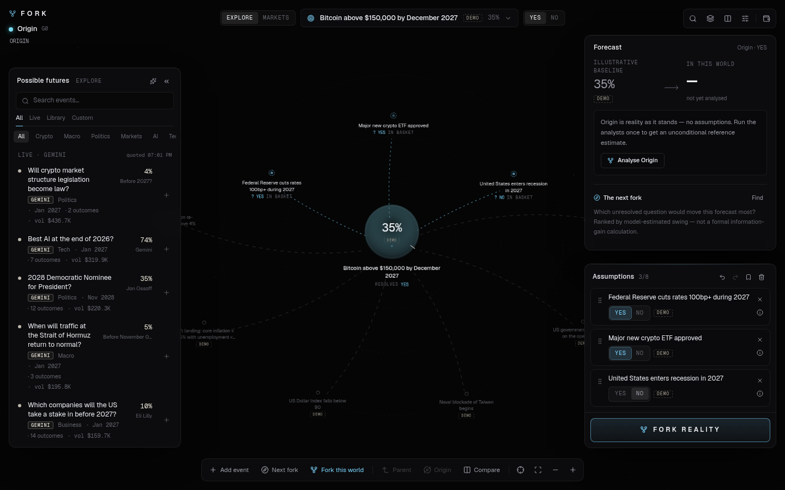 basket                                     |  fork · commit                     |
| 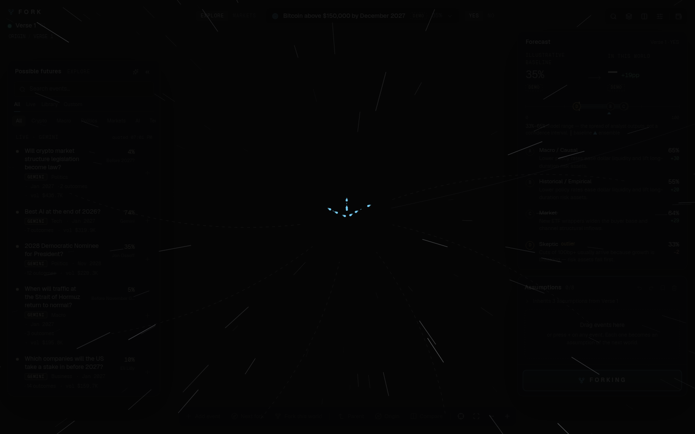 fork · converge / rupture           |  fork · travel                     |
| 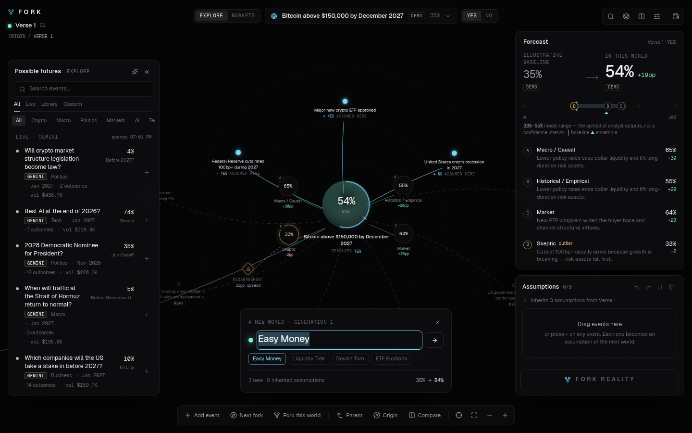 arrival + naming                   | 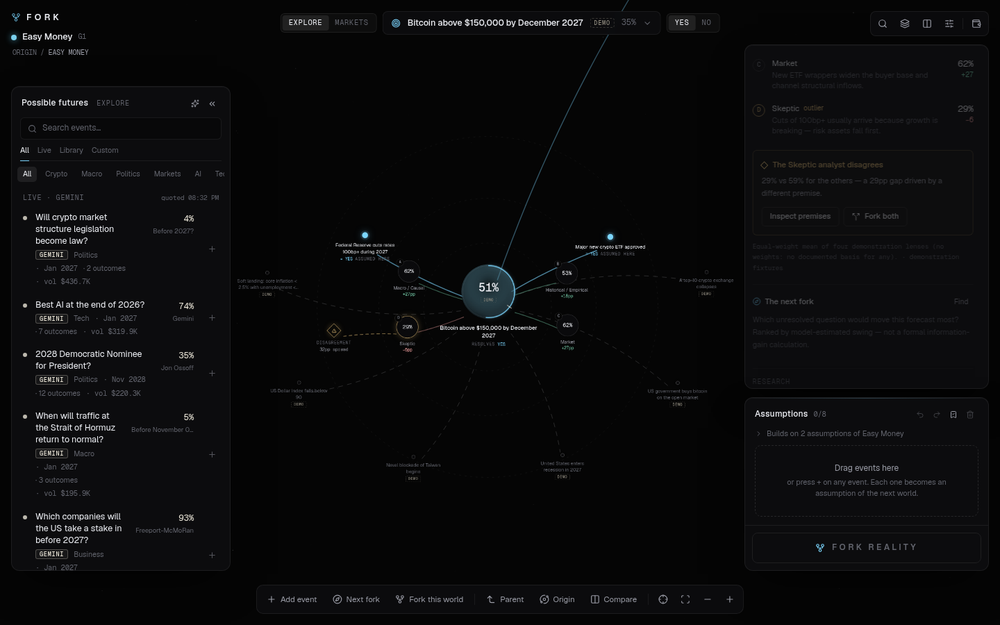 disagreement                     |
| 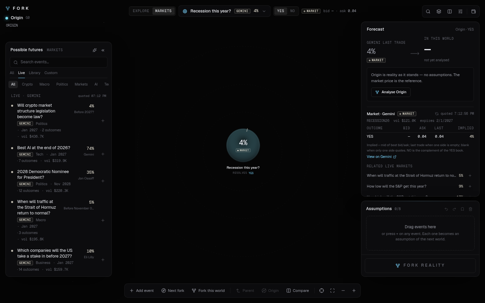 markets mode                         | 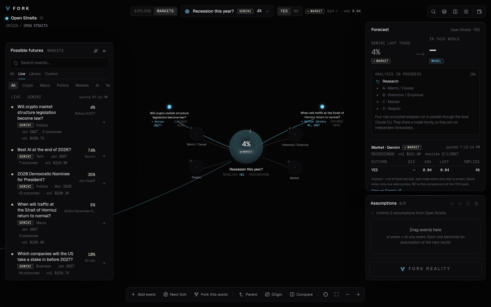 live analysis progress |
|  live Claude forecast         | 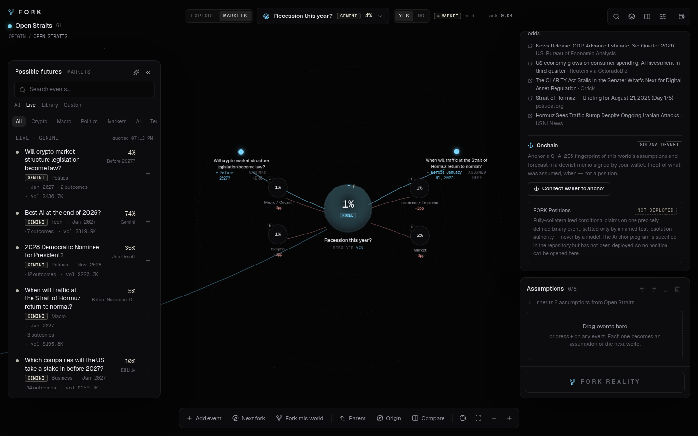 research + onchain       |
| 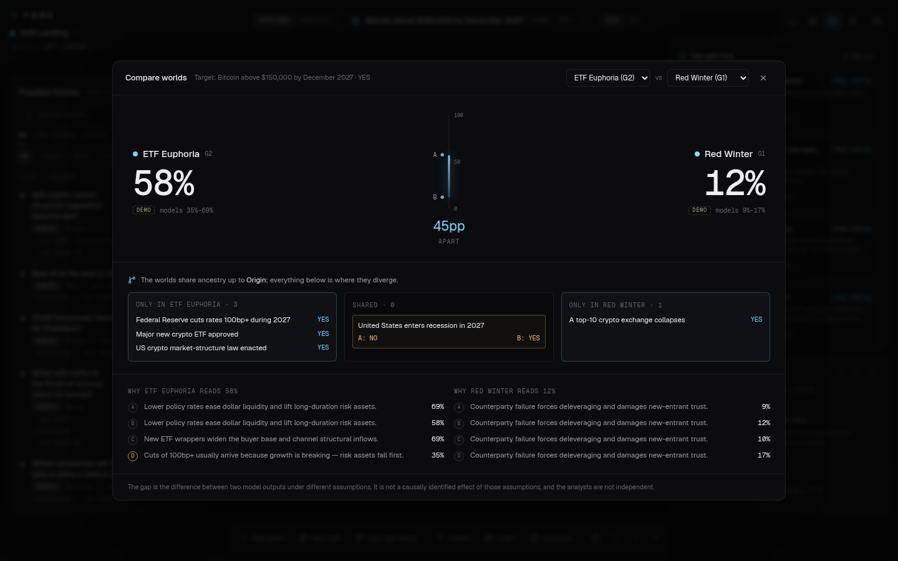 compare                                   |  universe overview           |
| 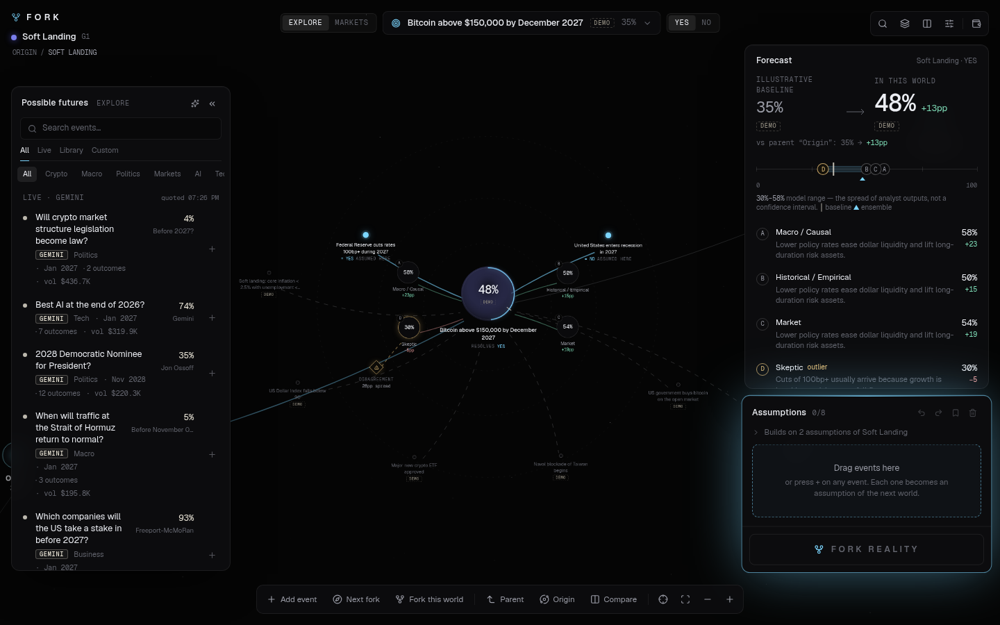 graph → basket (magnetic)     | 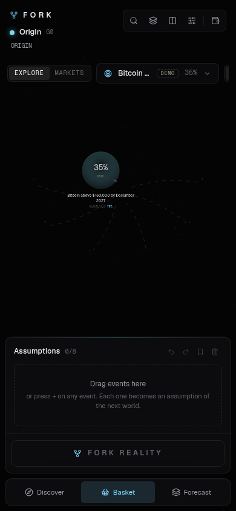 mobile                                 |
| 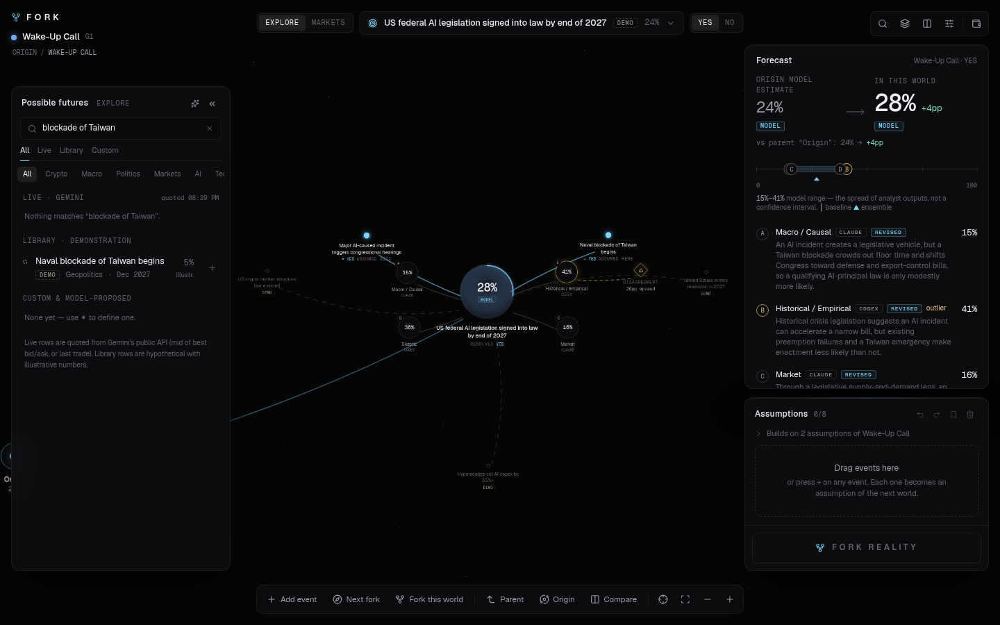 live mixed Claude + Codex | 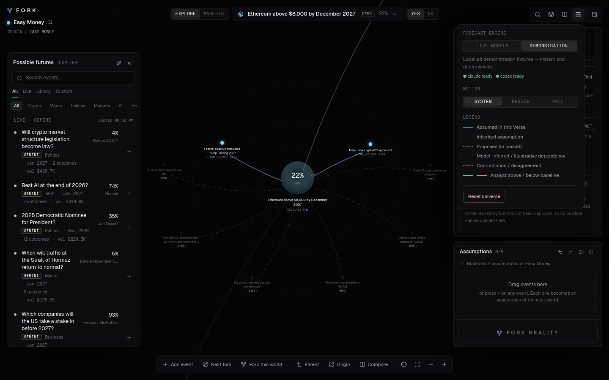 settings · providers       |
| 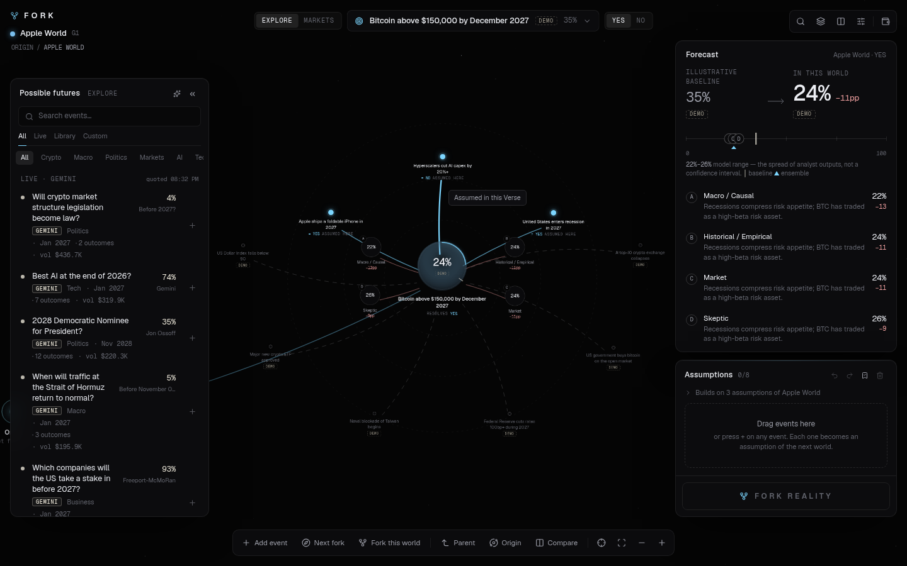 edge relationship hover                | 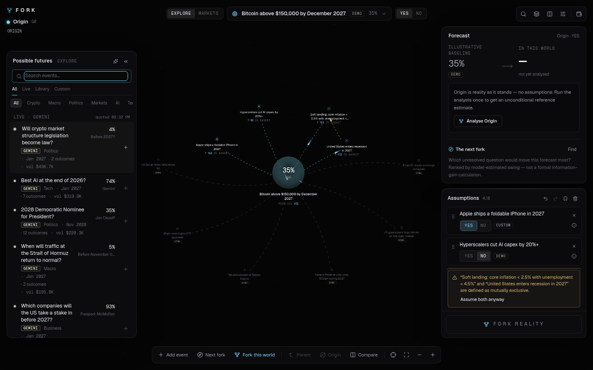 conflict warning             |

## Known limitations

- Solana devnet attestation is implemented but was not confirmed onchain from this server (faucet closed / RPC rate limits), and no wallet extension exists in headless tests.
- Conditional positions currently support one exact B given A=YES pair on a local validator with mock funds. The older `docs/legacy/fork_positions` draft is retained as historical source; the active backend is `contracts`.
- Live analysis takes about 1–3 minutes (research plus four parallel CLI runs). The UI shows real step-by-step progress rather than blocking. Analyses run inside the Next.js server process: a restart mid-run marks that job as lost rather than resuming it.
- Mixed mode uses two model families, but they are still not independent forecasters (shared research digest, overlapping training data). Single-provider modes share one family entirely.
- The demo library's baselines are illustrative. Research during testing put BTC near $65k in mid-2026, far from what the 35% demo baseline implies.
- Gemini categorical events: each outcome is a separate YES contract. FORK treats an assumption on a categorical event as choosing one outcome, so two outcomes of the same event can't both be assumed.
- The server mirror of the universe is keyed by an anonymous browser id. There is no restore-from-server UI if browser storage is wiped.
- Mobile uses a simplified layout (bottom sheet for Discover, Basket and Forecast). Dragging events into the basket is desktop-first; tap **+** on touch devices.
