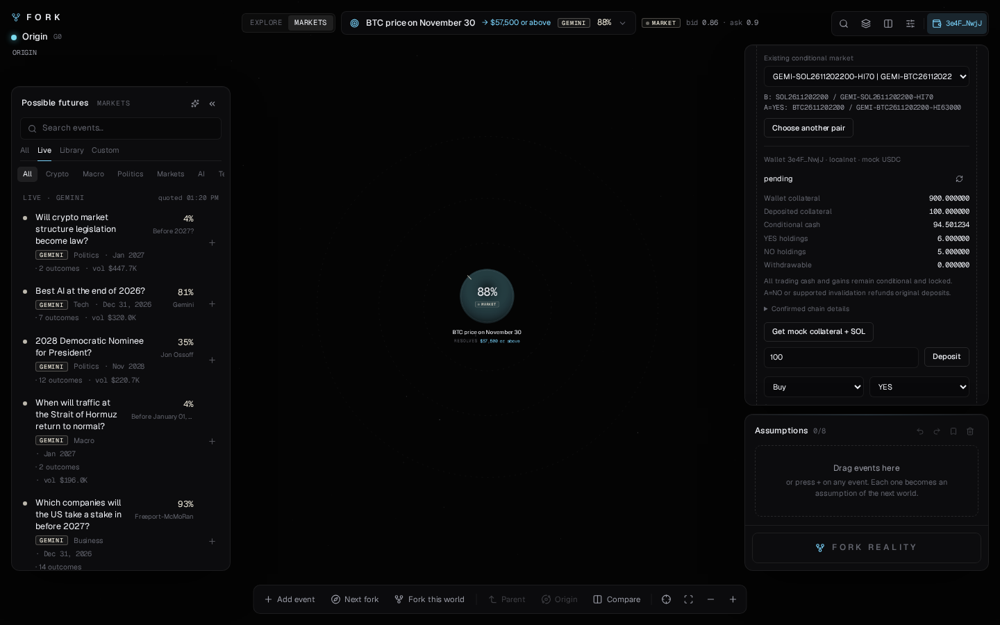
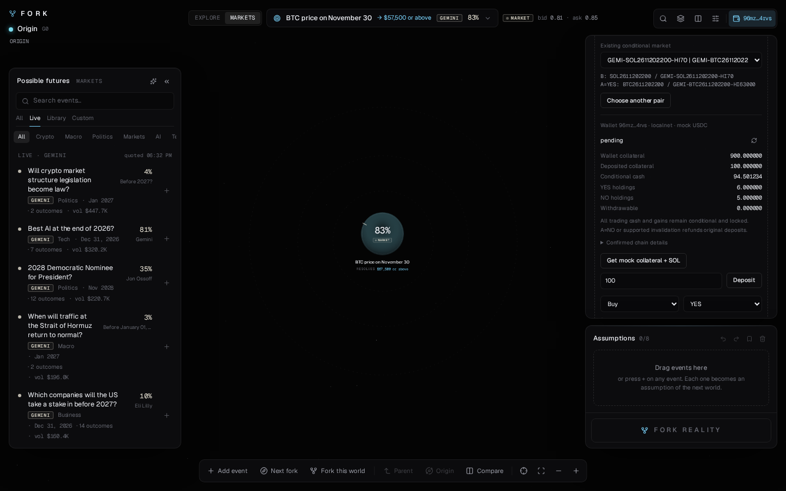

# Current verification — November 20, 2026

The current demo uses native SOL collateral and graph-linked wallet trading.
See [the current walkthrough](devnet.md) and [PR review notes](pr-review.md).
The November 19 evidence below is historical: its mock collateral, older UI,
addresses and test totals do not describe the current demo.

# Integration verification — November 19, 2026

## Consolidated project review

All active code now lives under `fork/`, with the Anchor workspace at
`fork/contracts/`. The review branch is `integration/solana-monorepo`.
The original contract metadata (an empty nested Git repository) is backed up
locally inside the root `.git`; contract sources are tracked as normal files.
No source changes, existing validator ledger or wallet balances were reset.

After the move, the Anchor build, 16 TypeScript contract tests, 17 Rust/SBF tests,
production Next.js build, frontend type check, lint and both formatting checks
passed. Both package lockfiles also passed `npm ci --dry-run --ignore-scripts`.
A stale Next.js build-cache failure was cleared by moving generated output aside
and completing a cold production build. Generated traces contain no contract
signers/ledger files, and the staged artifact/key scan passed.

The final browser rerun and its live transaction evidence are recorded at the end
of this report. The original evidence below remains as a historical run.

The original Fork application has been exercised in Chromium against a real local
Solana validator and live Gemini data. The original canvas, graph, typefaces,
layout, panels, basket and forecasting journey are retained. Trading is an
expandable card within the existing Onchain/Forecast panel. No mainnet deployment
or real collateral was used.

## Build and regression results

| Command (from the relevant project)                         | Result                                                                                      |
| ----------------------------------------------------------- | ------------------------------------------------------------------------------------------- |
| `fork/contracts: npm run build`                             | Anchor SBF build and actual generated IDL/types passed                                      |
| `fork/contracts: npm run app:sync`                          | Browser IDL, types and public DTOs copied from the real build                               |
| `fork/contracts: npm run typecheck`                         | Passed                                                                                      |
| `fork/contracts: npm test`                                  | 16 passed: catalog aliases, exact binding, source validation, oracle retries, research/math |
| `fork/contracts: cargo test --locked -- --nocapture`        | 17 passed: 2 unit + 15 actual SBF/LiteSVM tests                                             |
| `fork/contracts: cargo clippy --all-targets -- -D warnings` | Passed                                                                                      |
| `fork/contracts: npm run format:check`                      | Prettier and Rust formatting passed                                                         |
| `fork: npm run build`                                       | Production build passed with localnet public RPC configuration                              |
| `fork: npm run typecheck`                                   | Passed                                                                                      |
| `fork: npm run lint`                                        | Passed; generated builds, test reports and IDL are excluded                                 |
| `fork: npm run format:check`                                | All touched code/documentation passed                                                       |
| Original Fork browser/domain suite                          | 15 passed in development; original browser journey also passed against the production build |
| Confirmed SOL balance subscription                          | Focused production browser test passed                                                      |
| New integer collateral/claim tests                          | 2 passed                                                                                    |
| Live browser trading walkthrough                            | Passed in development; final production results below                                       |
| Synthetic browser settlement walkthroughs                   | VOID, settled YES and settled NO each passed in development; final production results below |

The toolchain emits its pre-existing SBF syscall/LTO warning and Node's SQLite /
punycode warnings. Actual validator and LiteSVM executions succeeded. The native
`bigint-buffer` binding is unavailable here, so its JavaScript fallback is used.
No claim of verification relies only on compilation or a simulated receipt.

Chromium initially could not launch because Linux shared libraries were missing.
System package installation was unavailable without a sudo password. The required
Ubuntu packages were downloaded and extracted under `/tmp/fork-browser-libs`, and
the tests ran with that directory in `LD_LIBRARY_PATH`. On a normal development
machine, `npx playwright install --with-deps chromium` supplies those dependencies.

## Actual live selection and rules review

| Role     | Exact Gemini event / instrument              | Observation / expiry |
| -------- | -------------------------------------------- | -------------------- |
| Parent A | `BTC2611202200 / GEMI-BTC2611202200-HI63000` | 2026-11-20 22:00 UTC |
| Target B | `SOL2611202200 / GEMI-SOL2611202200-HI70`    | 2026-11-20 22:00 UTC |

Both were active/open when selected. Searches used **Bitcoin** and **Solana** in
the actual application. The original target browser also selected the live
`BTC2611302200` event and displayed its Gemini book in Markets mode. The trading
card explicitly displays its own exact B | A=YES pair; a model/Verse target is
never silently treated as the same financial claim.

Reviewed source documents:

- [BTC Rule 13.135a](https://assets.gemini.com/predictions/terms_and_conditions/btc_398860b3-ea2f-47a7-b167-a8c6ad03d6d7.pdf)
- [SOL Rule 13.135c](https://assets.gemini.com/predictions/terms_and_conditions/sol_9cceb1a1-4177-401a-82dc-097ad2676bc2.pdf)

The rules describe observations at the specified expiration time, including a
possible averaging window and publication delay. Trading closes at the source
expiration time under section (f)(3). This local demonstration deliberately
committed **21:00 UTC on November 20** for both instruments, one hour earlier,
after reviewing the rules. The adapter still commits the separate 22:00
observation and waits for an actual supported source final report with its
publication time. It never invents finality from elapsed time.

Terms hashes (include descriptions, expiry, rules URL and downloaded PDF bytes):

- A: `e0bb7c20cf9a05be9b883d0c1c54025806ea4c2b1e059641523c5bcba0ed67d4`
- B: `f729c0518d874852a5b69a7586d29d5f2d1f5fa2fbb7b8ee7fc7879477c09071`

## Local deployment

- RPC: `http://127.0.0.1:18999`
- Genesis: `8naux5ngysqRDs8eZLYCNukRYjnh7Y1S1gLsd314QNdL`
- Program: `2Hfano51aQbCLFE5mf348CXRb4YEzpnqvow7ucCV6Lyv`
- Config: `9qekLknyPr38W9Mi7LmAFTFhW7YsNfVknhE1rS87cMMV`
- Mock six-decimal mint: `Ao1AHCFQgYHGvViiYDDeHVsqiXAS6qqk5Z3KM9diUXWp`
- Market: `Fj7edzNKGt5vZ38pMPNZ7C2ZFCUE3VRFPama3qfnEKSX`
- Vault: `CkbdqiSP45eug39D3tWenbJRwPR1h43jEovP6pjUWxpS`
- IDL SHA-256: `26aaed5a4d5ad01a18fe723505e1d7a1819b9222c833742fdeeeaae88b7bff37`

An older validator was already running on 8899. The new service detected its
stale binary and refused to initialize. That ledger was preserved. Verification
used the separate persistent `.local/app-validator` on 18999; the service's
binary comparison passed there. Restarting the service retained its original
config, mint, bindings and market. No nested Git repository was removed or reset.

## Browser flow and error cases

The live browser test uses a Wallet Standard bridge with two ephemeral local
signers. Only their public addresses enter the page; keys remain in the Node
test process. Browser transactions use the same production IDL client, simulated
quotes, wallet signing and RPC confirmation as extension wallets.

Verified steps:

1. Browse live Gemini in Fork and select exact A and B contracts in Positions.
2. Review rules and create/connect the actual on-chain conditional market.
3. Fund mock SPL collateral and SOL; reject a deposit in the wallet and verify
   no principal appears, then confirm a deposit of 100 mock USDC.
4. Obtain actual quote return data; buy 10 YES and 8 NO; sell 4 YES and 3 NO.
5. Compare every displayed principal/cash/share/collateral value to independently
   fetched program and SPL accounts after confirmation.
6. Switch to a second wallet, fund/deposit 100 and buy 2 NO. Switch back, reload
   the application, reconnect and recover the original account's values.
7. Check all recorded transaction signatures with `getTransaction`, require
   `meta.err === null`, and verify vault collateral equals LP plus trader deposits.
8. Reject insufficient collateral, simulate and reject a sell beyond holdings,
   expire a quote, disable premature redemption, and inject a clearly labeled
   source outage to verify execution stops. Source outage injection is an error
   test only; live trading uses unmodified Gemini responses.

Additional checks: an empty live catalog query returns `items: []` and
`hasNext: false`; cross-origin mock-faucet requests are rejected. Contract tests
cover close equality, slippage, malicious accounts, reserve constraints,
unauthorized/conflicting oracle reports and every settlement ordering.

## Deterministic settlement is separate from live verification

Three additional browser tests create isolated synthetic A/B registrations and
real local-validator positions. Test-only reporter instructions settle those
fixture markets to VOID, YES and NO. The app's real redemption button signs and
executes the claim, updates the wallet's SPL balance, shows zero remaining
withdrawable value and disables repeat redemption. The program's `claimed` flag
and confirmed transaction are independently checked.

Only public configuration/discovery DTOs are routed for these synthetic tests;
Solana account reads, signatures, simulations and redemptions are real. No
fixture outcome is submitted to the live Gemini-bound market or represented as
a Gemini attestation.

## Final production run

The final suite uses the production build at `http://127.0.0.1:3100`, the same
local validator, the restarted service, and the following command from `fork/`:

```bash
LD_LIBRARY_PATH=/tmp/fork-browser-libs/extracted/usr/lib/x86_64-linux-gnu \
BASE_URL=http://127.0.0.1:3100 RUN_SOLANA_E2E=1 RUN_SOLANA_FIXTURES=1 \
FORK_TEST_PARENT=GEMI-BTC2611202200-HI63000 \
FORK_TEST_TARGET=GEMI-SOL2611202200-HI70 \
FORK_TEST_PARENT_CLOSE=2026-11-20T21:00:00Z \
FORK_TEST_TARGET_CLOSE=2026-11-20T21:00:00Z npm test
```

These exact instruments are historical evidence, not reusable defaults after
they close. Future runs must select current instruments and review their rules.
Result: **21 passed in 4.1 minutes**, including all original tests, live trading,
three browser settlement fixtures and the integer-balance tests. The subsequent
wallet SOL subscription change passed an additional focused production
browser test (4.6 seconds): the popover updated from 0.000 to 1.000 SOL without
reconnecting, matching the independently fetched confirmed wallet balance.
The final production rebuild, type check, lint and formatting checks also passed.

### Confirmed live-account values

Recorded at 2026-11-19T18:23:11.852Z and checked against the displayed UI.
All amounts below are mock USDC or six-decimal shares.

| Step                 | Deposits   | Conditional cash | YES       | NO       | Wallet collateral | Withdrawable |
| -------------------- | ---------- | ---------------- | --------- | -------- | ----------------- | ------------ |
| deposit              | 100.000000 | 100.000000       | 0.000000  | 0.000000 | 900.000000        | 0.000000     |
| buy YES              | 100.000000 | 94.900031        | 10.000000 | 0.000000 | 900.000000        | 0.000000     |
| buy NO               | 100.000000 | 90.999992        | 10.000000 | 8.000000 | 900.000000        | 0.000000     |
| partial sells        | 100.000000 | 94.501234        | 6.000000  | 5.000000 | 900.000000        | 0.000000     |
| second wallet buy NO | 100.000000 | 98.994997        | 0.000000  | 2.000000 | 900.000000        | 0.000000     |
| reload and reconnect | 100.000000 | 94.501234        | 6.000000  | 5.000000 | 900.000000        | 0.000000     |

Wallet A: `3e4FnZPkqijnvxCHWMTcjRnn4coW9HdYKBNhK2dDNwjJ`.

Wallet B: `J12VQa22ZPbPypS7izVc8Pz8i9qRrQwV2Nak5BRM9GRj`.

The vault held **480.000000** = 80 LP subsidy + 400 cumulative trader
deposits from the two successful live walkthroughs. Existing positions from the
first pass were preserved. LMSR prices therefore reflected existing inventory on
the second pass; the client did not reset them or assume 50%.

### Confirmed live transaction evidence

All seven returned `meta.err = null`; each fee was 5,000 local lamports.

| Action        | Slot | Signature                                                                                  |
| ------------- | ---- | ------------------------------------------------------------------------------------------ |
| A deposit 100 | 2084 | `5hzHEszS1F9B5TTS9GxTDmC1t1w3xb3VpdKJjxSf3ZPmYjD8tQem9HQzSVkmZG261kWTyQsx3QGL9NQRFhJYz3ZD` |
| A buy 10 YES  | 2113 | `SPJC1jr2KRJEaq1vTGQm7sZ34nESu7gfUStYKQHoFipVBTEzSLBcCH9drnq1yrqxdcydte2thozH8QdYzEJkURh`  |
| A buy 8 NO    | 2135 | `h8GLzcpGjsYZkTfXRrEuEC7AS2do2tmuAb2kemv874xFMQztFo3nZgXCWSR6LL4jv5KXLTkey3uBgmcx1Z8ZPEK`  |
| A sell 4 YES  | 2155 | `tUZyoAQwBbE38m5FqMXTcGmPPdkWeVw4fYefYysSdk32hqSqSf7yqY9ikprTFokyWpUaxW88z9d7HGxbJ6WcZkV`  |
| A sell 3 NO   | 2183 | `3rgvrhUJtMXQC8DZEbHX1aKkWkZ7e38NRzujBB57DkieMEDBjBWEHrtdNbBqgrs8ZKPqUUhhxbvSY8DoRjPtdGJ7` |
| B deposit 100 | 2307 | `2EbLyTebE1Gu1tMcjq1oKEbyWBt3WbtZHJ46HG6RH8CFSMbT7JqYTeo4yUhfMdq8Q1kXkAf4ZSAbN9tkeX8cdu3Q` |
| B buy 2 NO    | 2327 | `5JdiPMmKKeGz2W6koBCPQmsUj7NcyfkuXRcyBf5cARNGhRMGPxLXhjctxrs2N2LTay7Z8aqPg9CVpsD8oX4xGi1V` |

Inspect a signature while the local ledger remains available:

```bash
NO_DNA=1 solana confirm -v 5hzHEszS1F9B5TTS9GxTDmC1t1w3xb3VpdKJjxSf3ZPmYjD8tQem9HQzSVkmZG261kWTyQsx3QGL9NQRFhJYz3ZD \
  --url http://127.0.0.1:18999
```

### Synthetic redemption evidence

These are isolated fixture markets, not live source settlements. Each payout was
verified in the UI and SPL account; the second claim was disabled.

| Fixture    | Actual mock payout | Confirmed redemption signature                                                             |
| ---------- | ------------------ | ------------------------------------------------------------------------------------------ |
| void       | 100.000000         | `2sdsh1AJuyLcp3xUVeApZD5RDFHrG6QMMcaX81pgk2P3fcotNbTshSW3onRBrh91zMjrZHKGPUGJKYY7nBXQ6Uw6` |
| settledYes | 104.875048         | `5eS1q3Fkw6qjjMzRBP4ztLBG1GRefnzHnAZaiXYMyVDTsTeRqaEGtcDTSEMmmA1W6SfVA6gs5RFCuWYcj4v4a8Hv` |
| settledNo  | 94.875048          | `4HZUkVB4AgpskpiVssqVi4a6bXpiaah3dkymqjxDb2NBQM6VCCzLTy4uEKyd395xJiuz8vbfwiuTGj4LSK8kiQZF` |

### Original interface with confirmed holdings



## Remaining limits and risks

- **Live Gemini settlement was not verified.** The selected events had not
  resolved. Their market remained Pending with zero withdrawable collateral.
- Browser verification uses an isolated Wallet Standard signing bridge, not an
  installed Phantom/Solflare/Backpack extension. Specific extension dialogs and
  their local-network support were not independently tested.
- The service is deliberately localhost-only. It holds development admin,
  reporter and mock mint authority keys in an ignored directory. Production
  authentication, independent oracle quorum, hardware/KMS signing, deployment
  monitoring and a security audit are outside this local integration.
- The underlying program still trusts one authorized reporter and its upgrade
  authority. Source outages or unsupported final source data can lock funds
  indefinitely. UI freshness gates do not remove that oracle trust assumption.
- `npm audit` in Fork reports 20 package findings (14 moderate, 6 high), including
  the legacy bigint-buffer advisory inherited through SPL Token, Anchor's TOML
  dependency and Next's PostCSS dependency. No breaking dependency upgrade or
  forced audit fix was applied. Do not use this demonstration with real money.
- The test wallets are ephemeral and use mock funds. Their retained live-market
  positions are verification artifacts, not recoverable user wallets. Local
  signatures remain inspectable only while the corresponding ledger is kept.
- Generic Boolean conditions, deeper tradable Verse trees, transferable shares,
  preterminal withdrawals and production LP management remain unsupported by
  the existing contracts and are not implied by the new UI.

## Post-consolidation browser result

The production app at `http://127.0.0.1:3100` and service running from
`fork/contracts` were retested against the preserved validator on port 18999.
The full 22-test run initially passed 21 cases and exposed duplicate lifecycle
sync signatures (`AlreadyProcessed`). The service now attaches a unique memo
to these idempotent refreshes. Contract type/format checks passed after the fix,
and the complete live trading test passed again in 2.3 minutes. All 55 distinct
contract/application tests therefore have passing results: 16 TypeScript contract
tests, 17 Rust/SBF tests and 22 application tests. No economic program logic was
changed for the sync fix.

The original UI regression journey, all three browser redemption fixtures and
the confirmed SOL subscription test passed in the consolidated layout. Live
Gemini settlement remains unverified because these events are still unresolved.

Latest live evidence recorded at 2026-11-19T23:34:45.044Z:

| Confirmed slot | Transaction signature                                                                      |
| -------------- | ------------------------------------------------------------------------------------------ |
| 10230          | `46XiHhfmMRWitwNi5Ay2BuNtwcP8w1aaptoHYfSihMJPjibdRnAd9bXFqVKVkrEV1XUjyDr1jLvwFFjCvLoHvQj8` |
| 10262          | `4TH3MUrV9pArD1MpifjRE7VVSzdB5A7AhY8spiFHLvhADDW52mEdDR7GnSHwmfnMQPn1fNovw1EQVMKghdPVa5Wz` |
| 10283          | `5vkWt1Xi1FrkpPd1mx4AbMDuN39opVDtw8MuTFeDSz3sCgYd2rk8VniPCr7Am5pbhvKzRmfwVZ9fgFDCCe28aN5n` |
| 10304          | `5L2YVK75RGdC4Gx1RJW6CSvVbky8VpDvM6X1fxUgKSWHsTDxZVqXCvPzwFWfA9f4wRSf3j8VYdcFVQZK5EJ82NMH` |
| 10335          | `5Zhvb33ttBHEUTZX7okvWkDkghZPfzrtF6j1xXbDsF8c8g6TK5vM1x4PWbr1c2KNk9VpPhaHuWZFUesu2nkTonQM` |
| 10452          | `mQUU8VFWiWRdVXAfau5V4kd1moQegRkFKFv1zC6g8W5rPtKip9hxpzs1fERcLaqepAX8XcSvZ2B6ifGJqKPKuu6`  |
| 10480          | `3BRgGUEGGJ2K5zoaqZrHv3h88d2qKSLyLDZsHnPNSXKVa24oQ7jkfKi3Rwcksfuu57w6L1g1zzbsCYd3ASFL95Lx` |

The test independently matched every displayed balance to confirmed program/SPL
accounts, checked every transaction for `meta.err = null`, and verified vault
collateral of 780.000000 mock USDC against cumulative LP and trader deposits.
Existing positions from earlier verification attempts were retained.



## Re-verification after merging into master — 2026-11-20

Branch `integrate/solana` = PR #1 merged onto master (Grok, ranked search, odds chart),
plus: committed generated IDL/types (the web app builds without Rust/Anchor/Solana),
a neutral "trading not enabled" state when `FORK_LOCAL_SERVICE` is unset, and an
opt-in devnet mode. Program ID changed to `13Z5QXDCa7bNddx55di4qxg7cAepcjy8BjDxag9bBJdN` (our keypair).
Toolchain: Rust 1.89.0, Solana/Agave 3.1.10, Anchor CLI 1.1.2, Node 24.

| Check                                              | Result                                                                                                                                                                                               |
| -------------------------------------------------- | ---------------------------------------------------------------------------------------------------------------------------------------------------------------------------------------------------- |
| `anchor build`                                     | passed (452,200-byte `.so`)                                                                                                                                                                          |
| contracts `npm test`                               | 16/16                                                                                                                                                                                                |
| `cargo test --locked`                              | 17/17 (2 unit + 15 SBF/LiteSVM)                                                                                                                                                                      |
| web `tsc`, `eslint`, `next build`                  | clean, with no contract toolchain needed at build time                                                                                                                                               |
| web unit tests                                     | 14/14                                                                                                                                                                                                |
| core browser journey, no Solana service            | 7/7; Positions card shows the neutral note, no errors                                                                                                                                                |
| synthetic settlement (VOID / YES / NO redeem once) | 3/3                                                                                                                                                                                                  |
| live trading, real Gemini instruments              | passed: A = `GEMI-BTC2611202200-HI62000`, B = `GEMI-SOL2611202200-HI67`, closes 2026-11-20T21:00Z; market `5T7GjFfo3DoqM9g4S2r6VpFMMRfN3zTWZ1vU9tQ3hg5L`; vault 280.000000 mock USDC; no page errors |
| wallet balance follows confirmed funding           | passed                                                                                                                                                                                               |

Sample local transaction signatures: `3HWkcZs9mU7CCjQ9…`, `444kW8pNadejxACn…`, `2eVbppYndBWGi1YN…`, `3UrQTxE3N4Aj5izM…`.
Live Gemini settlement is still unverified (the instruments resolve after this run).
